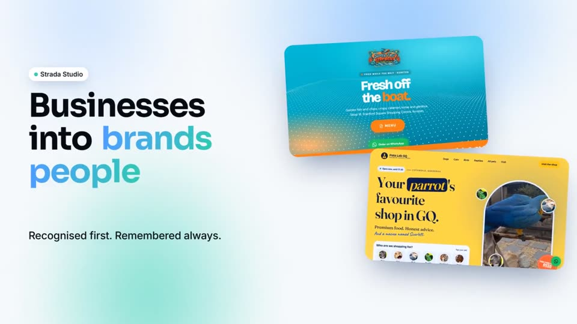
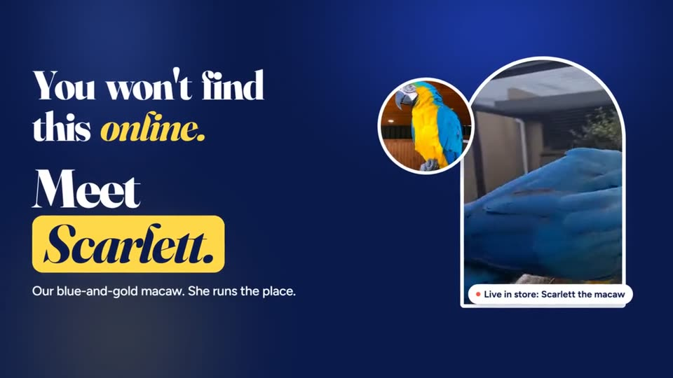
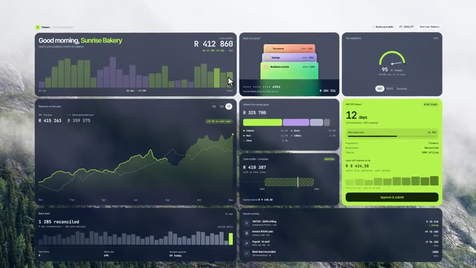
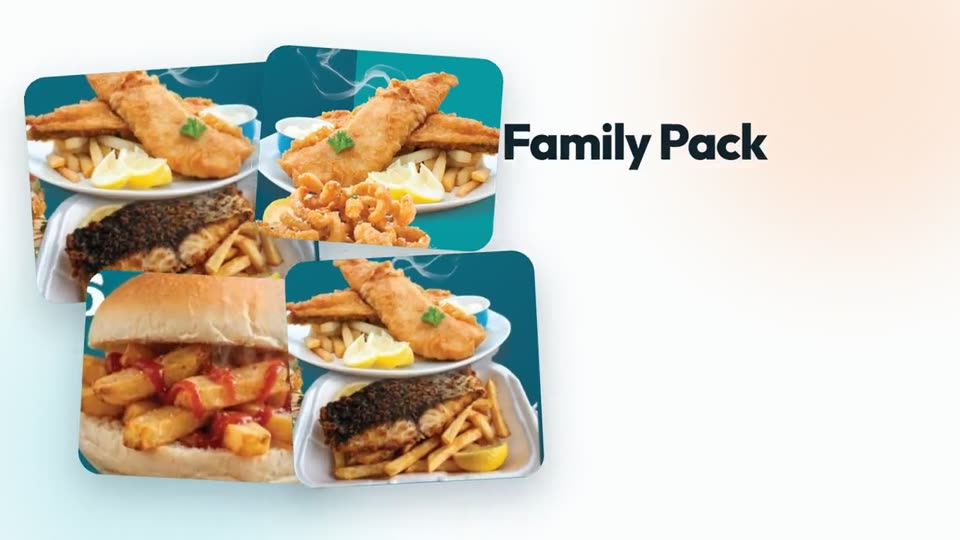

# Claude Videographer — AI brand-advertisement video skill

A reusable Claude Code skill that turns a short brief and a few brand assets into a finished, voiced, on-brand video ad.

## The problem
Small businesses need video for Reels, TikTok and Stories, but agencies are expensive and ad-hoc AI video tools produce inconsistent, off-brand results that have to be redone from scratch each time.

## What it does
1. **Takes a brief:** the business, its offer, its logo, colours and a handful of photos.
2. **Writes the script and shot list**, with the persuasion intent of each beat spelled out (hook, brand reveal, benefit, price, call to action).
3. **Generates an AI voice-over** and syncs the picture to word-level timestamps.
4. **Renders the video** from a data-driven template: scenes, timing, palette and assets are described in one blueprint file, so a new ad is a new blueprint rather than new code.
5. **Outputs** a social-ready MP4 in landscape or vertical.

## Examples made with it
Click a thumbnail to watch the video.

### Strada Studio — studio brand ad (35s)

### Pets Lab GQ — pet shop ad (42s)
Product-led story built around the shop's blue-and-gold macaw.

### Altus Accounting (Finworx platform) — accounting software ad (42s)
Animated dashboard story showing cash position, VAT readiness and the bank feed.

### Super Fast Seaflight — takeaway ad (40s)
Menu, price and WhatsApp-order story for a fish-and-chips shop in Korsten, Gqeberha.

## Stack
Claude Code skills, Remotion (React video), three.js, Python helpers for audio, AI voice and image services.

## Why it matters
It shows I can package an AI workflow into something repeatable: a defined input, a consistent process and a dependable output that a non-technical business owner can use.

## About this repository
This is a **showcase repository**. The skill's templates and prompts are my working IP, so they are kept private. © Craig Chadley Johnson. All rights reserved. See [LICENSE](LICENSE).

Built by [Craig Chadley Johnson](https://github.com/craig-builds) — johnsoncraig.dev@gmail.com
